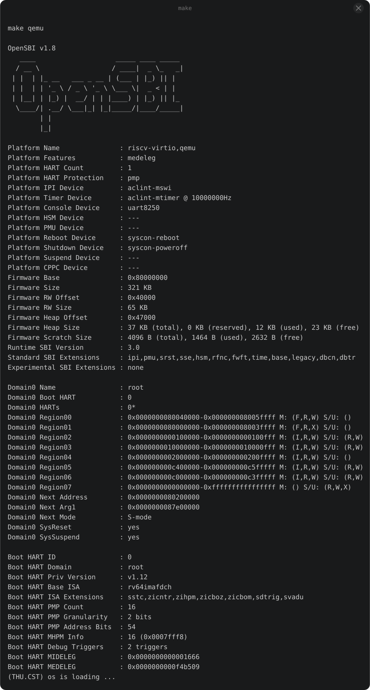
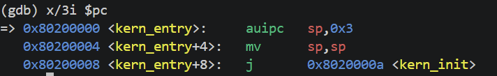
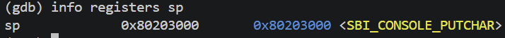

# 操作系统实验报告

## 实验基本信息

| 项目 | 内容 |
|------|------|
| **实验名称** | Lab 1: 最小可执行内核与启动流程 |
| **小组成员** | 2313551-王海同、2413354-李文俊、2410248-戴康宁 |
| **完成日期** | 2026-10-08 |

### 小组分工

| 成员 | 负责的练习/模块 |
|------|----------------|
| 2313551-王海同 | 练习1：理解内核启动中的程序入口操作 |
| 2413354-李文俊 | 练习2：使用GDB验证启动流程 |
| 2410248-戴康宁 | 实验报告整理、截图引用、提交 |

实验报告分工：王海同负责练习1内容撰写，李文俊负责练习2内容撰写，戴康宁负责整体格式整理、截图引用和提交。

---

## 一、实验目的

本实验的主要目的是：

1. 理解 QEMU 模拟的 RISC-V 计算机从加电到内核启动的完整流程。
2. 掌握链接脚本描述内存布局、交叉编译生成内核镜像的方法。
3. 学习使用 OpenSBI 作为 bootloader 加载内核，并用 GDB 验证启动流程。
4. 学习使用 AI 辅助开发操作系统核心功能。

---

## 二、实验环境

| 成员 | AI 编程工具 | 底层模型 | 备注 |
|------|------------|---------|------|
| 2313551-王海同 | Cline（VS Code插件） | DeepSeek-V4-Flash | API 配置 |
| 2413354-李文俊 | Cline（VS Code插件） | DeepSeek-V4-Flash | API 配置 |
| 2410248-戴康宁 | Cline（VS Code插件） | DeepSeek-V4-Flash | API 配置 |

**说明：**
- **AI 编程工具**：指具体使用的终端工具、编辑器插件、桌面应用或浏览器界面
- **底层模型**：指该工具使用的大语言模型及版本

---

## 三、实验整体逻辑分析

### 3.1 本章节的逻辑主线

本章围绕"从固件到内核"的启动顺序展开，解决的核心问题是：**如何让一个最小可执行的内核在 QEMU 模拟的 RISC-V 计算机上正确启动并输出信息。**

### 3.2 功能的逐步实现

本章按照以下顺序逐步实现：

1. 首先**硬件加电，CPU 从 0x1000 进入 MROM** → 这是 QEMU 模拟的复位地址，是启动流程的起点。
2. 接着**跳转到 0x80000000 的 OpenSBI** → OpenSBI 作为 bootloader 完成硬件初始化。
3. 然后**OpenSBI 将内核加载到 0x80200000** → 这个地址由链接脚本指定，是内核运行的固定位置。
4. 接着**内核入口 entry.S 设置内核栈** → 为 C 语言函数调用建立栈环境。
5. 最后**kern_init 清空 .bss 段，通过 cprintf 输出信息** → cprintf 底层通过 ecall 调用 OpenSBI 服务，完成字符输出。

---

## 四、实验内容与实现

### 练习1：理解内核启动中的程序入口操作

**负责人：** 2313551-王海同

`kern/init/entry.S` 中：

- `la sp, bootstacktop`：将内核栈指针 `sp` 设置为 `bootstacktop` 的地址。RISC-V 栈向低地址增长，所以把 `sp` 设在栈顶高地址处，后续压栈时不会越界。目的是为 C 语言函数调用建立栈环境。
- `tail kern_init`：以尾调用方式跳转到 `kern_init` 函数，不保存返回地址。因为 `kern_init` 是内核入口函数，内部是死循环，永不返回。目的是将 CPU 控制权从汇编代码移交给 C 语言编写的内核初始化函数。

#### 最终提示词

我看 `entry.S` 里的 `la sp, bootstacktop`，知道是设置栈指针，`tail kern_init` 是跳到 C 函数。但我不太明白：为什么内核栈要放在 `.data` 段而不是 `.bss` 段？

#### 实现迭代过程

##### 第一次迭代

**遇到的问题：**
- 对 `entry.S` 中两条汇编指令的作用理解不够深入，不确定栈为什么放在 `.data` 段。

**问题解决策略：**
- 向 AI 提问，确认了 RISC-V 栈向低地址增长的特性，以及 `.bss` 段会在 `kern_init` 中被清空，所以栈必须放在 `.data` 段。

**最终结果：**
- 理解了两条指令的作用和栈的存放位置。

---

### 练习2：使用GDB验证启动流程

**负责人：** 2413354-李文俊

#### 调试过程

1. 终端A运行 `make debug`，QEMU启动并暂停，等待GDB连接。
2. 终端B运行 `make gdb`，GDB连接成功。
3. `info registers pc` 显示PC停在 `0x1000`，这是QEMU模拟的复位地址。
4. `x/4i $pc` 查看 `0x1000` 处的指令，是QEMU内置固件的复位代码。
5. `b *0x80200000` 在内核入口设断点，`c` 继续执行。
6. GDB停在内核入口 `0x80200000`，`x/3i $pc` 显示此处是 `kern_entry` 的指令。
7. `si` 单步执行，`info registers sp` 观察到 `sp` 被设置为 `0x80203000`，验证了内核栈的初始化。
8. 继续 `si`，进入C语言函数 `kern_init`，停在 `init.c:8`。

#### 问题回答

RISC-V硬件加电后最初执行的指令位于地址 `0x1000`，这是QEMU模拟的复位向量地址。这些指令主要完成最基础的硬件初始化，并负责将OpenSBI固件加载到 `0x80000000` 处，然后将控制权交给OpenSBI，由OpenSBI继续完成内核加载和启动工作。

#### 最终提示词

用 GDB 调试时，我看到 PC 从 `0x1000` 变到 `0x80000000`，再变到 `0x80200000`。这三个地址分别是什么？是固定的吗？为什么内核一定要加载到 `0x80200000`，换个地址不行吗？

---

## 五、测试与验证

**测试截图：**

---

## 六、实验总结与收获

### 对操作系统的理解

1. **重要知识点与 OS 原理对应：**

| 本实验知识点 | OS原理知识点 | 关系与差异 |
|---|---|---|
| 链接脚本指定加载地址 | 程序内存布局/地址空间 | 链接脚本是静态布局，OS原理中地址空间是动态管理的 |
| entry.S设置内核栈 | 函数调用栈 | 内核栈是OS运行的基础，OS原理中栈用于函数调用和中断处理 |
| ecall调用SBI服务 | 系统调用/特权级切换 | ecall是RISC-V特权级切换指令，系统调用是其典型应用 |
| cprintf输出 | 设备驱动/IO管理 | cprintf是简单封装，OS原理中IO管理更复杂 |

2. **OS 原理中重要但本实验未对应的知识点：**
- 进程管理与调度
- 虚拟内存与分页
- 文件系统
- 中断与异常处理的完整流程
- 设备驱动的完整框架

### AI 协作开发的经验

- AI 可以帮助快速定位和解决环境配置问题。
- 对于底层汇编和硬件细节，AI 能提供清晰的解释，帮助建立直觉。
- AI 生成的提示词和报告模板可以作为参考，但需要根据实际情况调整。
