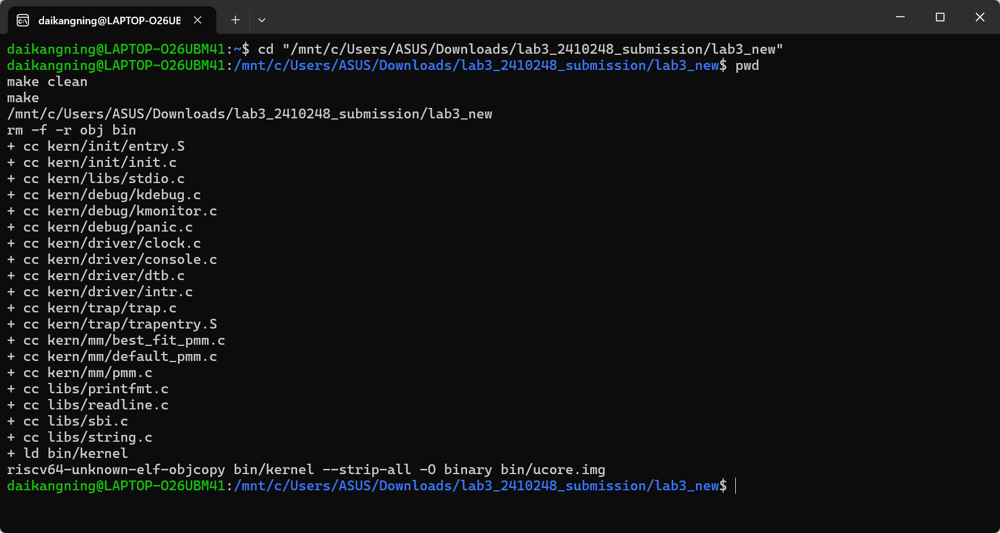
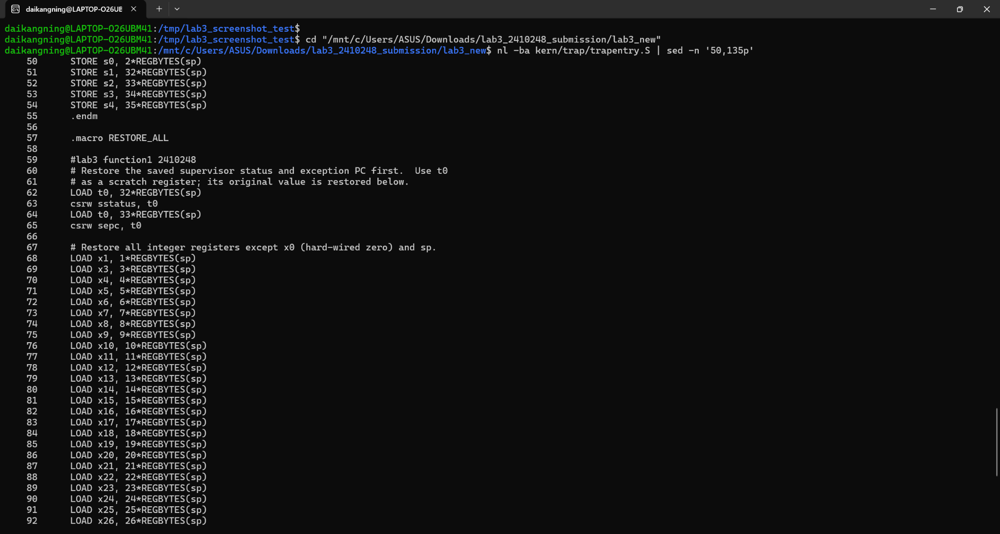
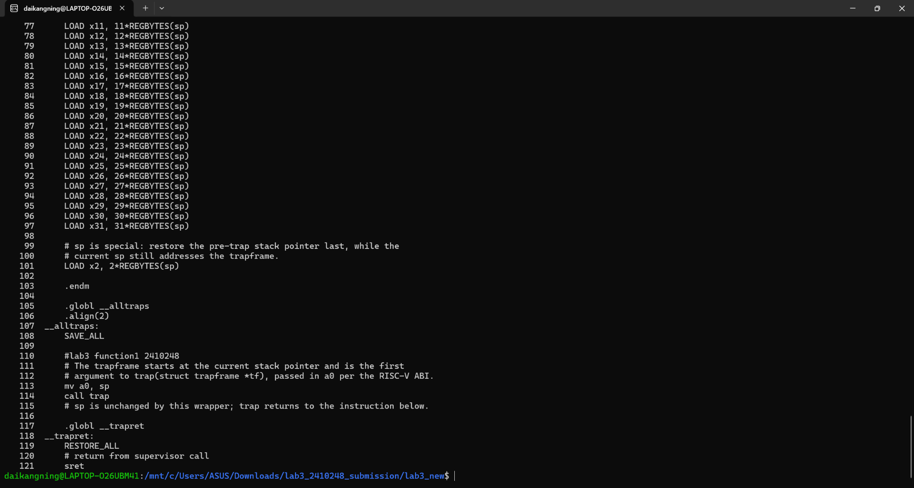
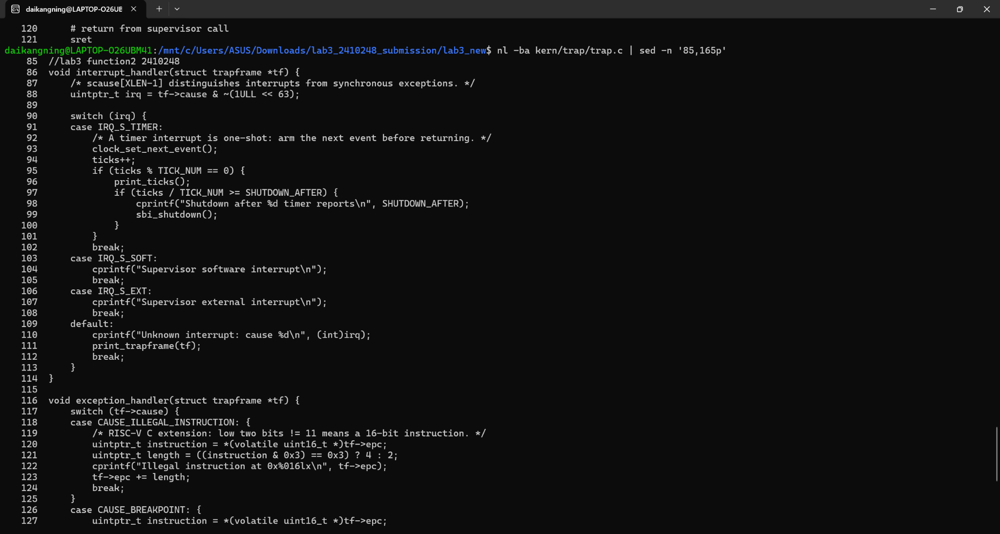
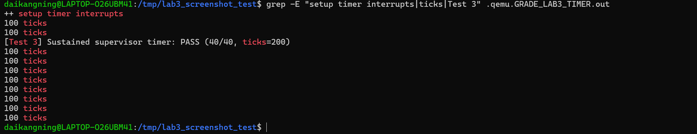
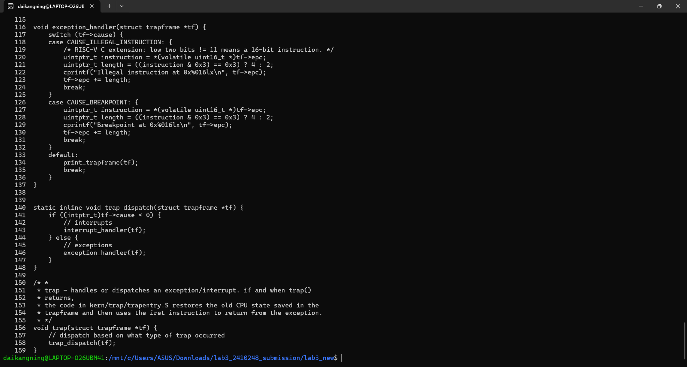
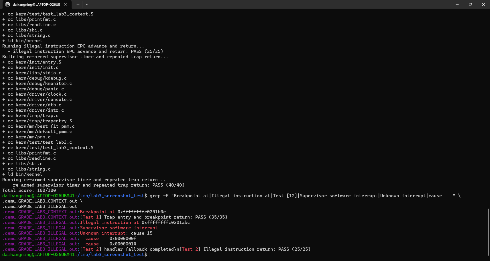
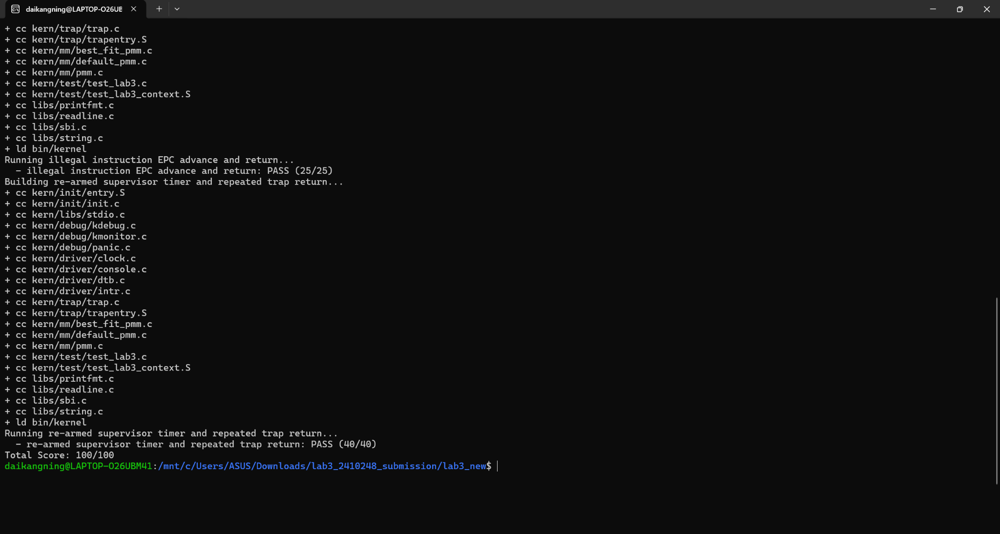

# 操作系统实验报告

## Lab 3：断，都可以断——RISC-V Trap、中断与异常处理

| 项目 | 内容 |
|---|---|
| 实验名称 | Lab 3：断，都可以断 |
| 小组成员 | **2313551－王海同、2413354－李文俊、2410248－戴康宁** |
| 实验日期 | 2026 年 11 月 5 日（本次验证记录） |
| 体系结构 | RV64 / RISC-V Supervisor 模式 |
| 代码目录 | `lab3_new/` |
| 实验报告 | `report/report.md` |
| 最终评分 | **100/100（实际 WSL 运行截图）** |

### 小组分工

| 成员 | Lab 3 分工 |
|---|---|
| **2313551－王海同** | Trap 入口与返回流程、`SAVE_ALL` / `RESTORE_ALL`、CSR 与上下文保存原理分析 |
| **2413354－李文俊** | `interrupt_handler()` / `exception_handler()` 的机制分析；定时器重装与 EPC 处理 |
| **2410248－戴康宁** | 工程整合、WSL/QEMU 编译与调试、功能验收、截图整理及报告编写 |


---

## 一、实验目的

1. 理解 RISC-V 中断（interrupt）与异常（exception）的区别及 Trap 处理机制。
2. 理解 `stvec`、`sscratch`、`sstatus`、`sepc`、`scause`、`stval` 等 Supervisor CSR 的用途。
3. 完成 Trap 上下文的保存、传递、恢复以及 `sret` 异常返回。
4. 实现断点和非法指令处理，正确跳过触发异常的 16 位或 32 位指令。
5. 实现可反复触发的 Supervisor Timer Interrupt，通过 `ticks` 验证计时行为。
6. 学会在 WSL/QEMU 上区分**构建失败**、**固件启动失败**、**内核启动失败**和**Trap 业务逻辑失败**，形成可复现的调试记录。

## 二、实验环境与复现方法

| 项目 | 本次实际环境 |
|---|---|
| 宿主环境 | Windows + WSL2 Ubuntu |
| 编译器 | `riscv64-unknown-elf-gcc` 14.2.0 |
| 模拟器 | `qemu-system-riscv64` 10.2.1 |
| 调试工具 | `gdb-multiarch` 17.1（用于环境准备；本次评分以 QEMU 功能测试为准） |
| 固件 | QEMU `-bios default` 启动的 OpenSBI v1.8 |
| 指令体系 | RV64，采用 Sv39 地址翻译，QEMU `virt` 机器 |

本实验在 WSL2 的 Lab 3 工程目录中构建与测试；提交包根目录为 `lab3_new/`。

```bash
cd lab3_new
make clean
make
make grade
```

**QEMU 启动兼容性：** 原始评分脚本的 QEMU 启动方式为 `-device loader,file=bin/ucore.img,addr=0x80200000`。在本机使用时，OpenSBI 的 `Domain0 Next Address` 显示为 `0`，内核没有开始输出。将本地评分脚本的启动参数调整为 `-kernel bin/ucore.img` 后，OpenSBI 下一跳正确显示 `0x80200000`。**测试项目、得分条件和断言文本未改动**。提交版本保留这一条 QEMU 启动兼容性修改。



## 三、本章节整体逻辑

### 3.1 逻辑主线

Lab 1 解决“内核怎样启动”，Lab 2 解决“内核怎样管理物理内存与建立页表”，Lab 3 则解决“**内核正在执行时，硬件事件或异常指令怎样安全地打断当前执行流，然后恢复执行**”。

整体路径如下：

```text
中断/异常产生
  → CPU 保存 Trap 元信息到 sepc / scause / sstatus / stval
  → 跳转至 stvec 指向的 __alltraps
  → SAVE_ALL 生成 TrapFrame（32 个 GPR + 4 个 CSR）
  → a0 = sp；调用 trap(struct trapframe *tf)
  → trap_dispatch：按 scause 最高位分类
      ├── interrupt_handler：定时器、软件/外部、未知中断
      └── exception_handler：非法指令、断点、其他异常
  → 对需要跳过的指令调整 tf->epc；对定时器设置下一次事件
  → __trapret / RESTORE_ALL 恢复 sstatus、sepc、GPR
  → sret 恢复执行
```

### 3.2 初始化关系

程序从 `kern_entry` 进入 `kern_init()`。初始化过程包含清零 BSS、读取 DTB、控制台、打印内核信息、注册 Trap 向量、物理内存管理、设置定时器和打开中断。由课程测试注入的 `test_lab3_exception_context()` 在打开时钟中断前执行；定时器测试通过 `test_lab3_wait_for_timer()` 观测 `ticks` 增长。

这里有一个跨实验依赖：如果 Lab 2 的 `page_init()` 或 Best-Fit 未正确迁移，Lab 3 即使 Trap 函数本身无误，也无法成功构建或进入测试。

## 四、功能模块与核心函数

### 4.1 TrapFrame 布局与 `SAVE_ALL`

**文件：** `kern/trap/trap.h`、`kern/trap/trapentry.S`。

`struct trapframe` 由 `struct pushregs`（32 个 `uintptr_t`，对应 x0 到 x31）及 `status`、`epc`、`badvaddr`、`cause` 四个字段组成。RV64 中 `REGBYTES = 8`，总计 `36 × 8 = 288` 字节。`SAVE_ALL` 按槽位写入寄存器：`x1` 对应第 1 槽；原始 `sp` 先保存在 `sscratch`，再放入第 2 槽；四个 CSR 依次占第 32～35 槽。

`stval` 是当前汇编器识别的 CSR 名称，与旧代码中 `sbadaddr` 指向相同的 CSR 编号 0x143；本次出现的旧名编译错误已改为 `stval`。

### 4.2 `RESTORE_ALL` 与 `__alltraps`

**Spec：** 接收 `SAVE_ALL` 建立的 TrapFrame；恢复 `sstatus` 和 `sepc`，再恢复通用寄存器；`sp` 必须最后恢复；TrapFrame 指针按 RISC-V ABI 从 `a0` 传入 `trap()`。

实现中先使用临时寄存器 `t0` 从栈槽读取状态和 EPC：

```asm
LOAD t0, 32*REGBYTES(sp)
csrw sstatus, t0
LOAD t0, 33*REGBYTES(sp)
csrw sepc, t0
```

再逐个恢复 x1、x3～x31。由于恢复期间所有槽位都依赖当前 `sp` 寻址，必须把 `LOAD x2, 2*REGBYTES(sp)` 放在最后。`__alltraps` 通过 `mv a0, sp`、`call trap` 进入 C 处理函数，最终在 `__trapret` 中执行 `RESTORE_ALL` 与 `sret`。保存/恢复 288 字节保持了原本 16 字节对齐的栈对齐性。

**验证：** `test_lab3_register_context()` 在 `ebreak` 前给多个通用寄存器装入固定数值，Trap 返回后逐项比较；第一项测试实际为 **PASS (35/35)**。





### 4.3 `idt_init()`、`trap()` 与 `trap_dispatch()`

**文件：** `kern/trap/trap.c`。

`idt_init()` 设置 `sscratch = 0`，并将 `stvec` 指向 `__alltraps`。`trap(struct trapframe *tf)` 调用 `trap_dispatch(tf)`。`trap_dispatch` 把 `tf->cause` 当作有符号整数判断最高位：最高位为 1 表示中断，否则表示同步异常。这个位的含义不是异常编号的一部分，进入中断分支后应先去掉最高位再解析 IRQ 类型。

### 4.4 `interrupt_handler()` 与定时器连续触发

**文件：** `kern/trap/trap.c`、`kern/driver/clock.c`。

**Spec：** `IRQ_S_TIMER` 每次要重设下一次时钟事件、更新全局 `ticks`，每累计 `TICK_NUM=100` 次打印一次，并支持 `SHUTDOWN_AFTER=10` 次报告后的关机逻辑；其余已知中断分类输出，未知中断打印原因和 TrapFrame。

核心代码：

```c
case IRQ_S_TIMER:
    clock_set_next_event();
    ticks++;
    if (ticks % TICK_NUM == 0) {
        print_ticks();
        if (ticks / TICK_NUM >= SHUTDOWN_AFTER) {
            cprintf("Shutdown after %d timer reports\n", SHUTDOWN_AFTER);
            sbi_shutdown();
        }
    }
    break;
```

`clock_init()` 使能 `sie` 中的 Supervisor Timer Interrupt，并调用 `clock_set_next_event()` 设置首次时钟事件。`clock_set_next_event()` 使用 `rdtime` 获取计数，再通过 SBI 设置 `当前时间 + timebase`；本代码 `timebase=100000`，在 QEMU 10 MHz 时间基准下相当于约 10 ms。`intr_enable()` 则打开 `sstatus.SIE`。因此必须区分“设置了 `sie.STIE`”和“真正开启了全局中断”两个步骤。

软件中断输出 `Supervisor software interrupt`；外部中断输出对应提示；未知中断输出原因编号，并打印寄存器和 TrapFrame 状态。第三项测试确认 `ticks` 能达到 **200**，实际为 **PASS (40/40)**。

**截图说明：** 输出中多次显示 `100 ticks`，是因为 `print_ticks()` 打印固定常量 `TICK_NUM`，不是 `ticks` 始终为 100。实际累计次数由测试的 `ticks=200` 证明。





### 4.5 `exception_handler()`：断点与非法指令

**Spec：** 处理 `CAUSE_BREAKPOINT`、`CAUSE_ILLEGAL_INSTRUCTION`；打印异常发生地址，跳过异常指令继续执行；无法识别的同步异常打印 TrapFrame。

由于 QEMU 启用了 RISC-V C 压缩指令扩展，指令可能为 16 位或 32 位。处理函数读取 EPC 对应的低 16 位，按 `instruction & 0x3` 判断：若末两位是二进制 `11`，则长度取 4，否则取 2，然后执行：

```c
uintptr_t instruction = *(volatile uint16_t *)tf->epc;
uintptr_t length = ((instruction & 0x3) == 0x3) ? 4 : 2;
tf->epc += length;
```

不修改 `epc` 会导致返回后重试同一条触发异常的指令，形成重复 Trap；一律 `epc += 4` 则可能跳过压缩指令后的有效代码。定时器中断不同于这里的异常，正常处理中通常不应跳过被打断的指令。

测试中，`ebreak` 后的寄存器检查全部成功；非法指令测试使用 4 字节无效 opcode，并验证未知中断和其他异常的兜底路径；第二项测试实际为 **PASS (25/25)**。





## 五、模块实现要求与验证原则

### 5.1 Trap 入口与现场恢复

Trap 入口需要完整保存通用寄存器和关键 CSR，按既定 TrapFrame 布局传递给 C 处理函数。返回前恢复 `sstatus`、`sepc` 和通用寄存器，并将原始 `sp` 放在最后恢复，以保证栈寻址过程正确。

### 5.2 中断与异常处理

通过 `scause` 最高位区分中断和同步异常。定时器中断需要重新设置下一次时钟事件并更新 `ticks`；断点和非法指令处理需要根据指令长度调整 EPC，避免返回后重复执行同一条异常指令。

### 5.3 验证原则

验证按编译、链接、QEMU 启动和功能测试逐步进行。每项功能以实际运行输出和评分脚本结果为依据，不将构建成功等同于功能测试通过。

## 六、工程调试记录与问题修复

### 6.1 旧 CSR 名称导致汇编失败

**现象：** `kern/trap/trapentry.S:47: Error: unknown CSR 'sbadaddr'`。**原因：** 所用 GNU 汇编器接受标准 CSR 名称 `stval`，不接受旧名称 `sbadaddr`。**处理：** 将 `csrr s3, sbadaddr` 改为 `csrr s3, stval`。**结果：** 后续构建越过此错误。

### 6.2 Lab 2 物理内存管理未迁移完整

**现象：** `best_fit_pmm.c` 中 `free_list`、`nr_free` 未声明，三个测试全部停在编译阶段。**原因：** Lab 3 初始集成缺少先前 Lab 2 的 Best-Fit 定义和 `page_init()` 实现。**处理：** 从已完成的 Lab 2 代码迁移 `best_fit_pmm.c`，补齐 `pmm.c` 的 `page_init()`。**结果：** 能编译全部测试并链接 `bin/kernel`。

### 6.3 OpenSBI 能启动但没有内核输出

**现象：** 三项运行日志只有 OpenSBI 信息，最初 `Domain0 Next Address = 0x0000000000000000`，没有 `(THU.CST) os is loading ...`。**原因与处理：** 本机 QEMU 10.2.1 / OpenSBI 对原评分脚本的 `-device loader` 方式未建立有效的启动下一跳；仅在本地评分脚本改为 `-kernel bin/ucore.img`，后续 Next Address 正常为 `0x80200000`。**结果：** 解决了固件下一跳配置，但内核初始化尚未成功，评分仍为 0 分。这表明不能把所有运行故障都归因于 Trap 函数。

### 6.4 Sv39 启动页表缺少恒等映射（最终关键问题）

**现象：** 修复 Next Address 后，QEMU 依然只有 OpenSBI 输出，无内核启动信息。**原因：** `entry.S` 执行 `csrw satp` 启用 Sv39 时，PC 尚处于物理地址 `0x80200000` 附近；原启动页表只有高地址映射，未把低地址当前取指范围映射回自身，分页启用后可能无法继续取指。

**修复：** 在 1 GiB 叶子页表映射中，将索引 2 设为 `0x80000000` 对应的恒等映射，索引 511 保留为内核高地址映射；本次代码采用：

```asm
boot_page_table_sv39:
    .zero 8 * 2
    .quad (0x80000 << 10) | 0xcf
    .zero 8 * 508
    .quad (0x80000 << 10) | 0xcf
```

其中 `2 + 1 + 508 + 1 = 512` 个 Sv39 根页表项。修复后在调试副本中第一次得到 **35/35 + 25/25 + 40/40 = 100/100**，再把修改同步到正式目录，正式目录复测同样是 **100/100**。

### 6.5 关于调试方法的反思

这次调试区分了：汇编阶段 CSR 名称错误、C 编译阶段缺少 PMM 变量、OpenSBI 下一跳无效、Sv39 启动时取指故障。评分为 0 只能表明测试未通过，不能据此证明 Trap 处理函数的算法一定错。只有在内核确实启动且打印出测试日志后，评分结果才可用于评价具体处理逻辑。

## 七、测试与验证

### 7.1 正式目录编译

在正式目录执行 `make clean; make`，成功编译 `kern/trap/trap.c`、`kern/trap/trapentry.S` 等文件，链接 `bin/kernel`，使用 `objcopy` 生成 `bin/ucore.img`。证据见图 1。

### 7.2 评分测试实测

在正式目录执行 `make grade`，测试脚本包含三个测试及相同的断言要求，实际输出为：

| 测试项目 | 检查重点 | 实测结果 |
|---|---|---|
| Trap 入口、寄存器恢复与断点 EPC | `ebreak` 后寄存器值正确恢复；打印 Breakpoint | **PASS（35/35）** |
| 非法指令 EPC 前进及返回 | 32 位非法指令跳过；软件中断、未知原因输出 | **PASS（25/25）** |
| Supervisor 定时器重装及返回 | 持续处理到 `ticks=200`，打印 `100 ticks` | **PASS（40/40）** |
| **总分** | | **100/100** |

```text
  - trap entry, register restore, and breakpoint EPC: PASS (35/35)
  - illegal instruction EPC advance and return: PASS (25/25)
  - re-armed supervisor timer and repeated trap return: PASS (40/40)
Total Score: 100/100
```

**证据：** 图 2 为正式提交目录运行 `make grade` 的成绩；图 3 与图 4 来自保存了 `.qemu.GRADE_LAB3_*.out` 的独立调试副本。调试副本使用相同的源码与评分逻辑，保留了原始 QEMU 串口信息。



### 7.3 测试边界

本次已真实验证三项评分测试及总分。不把尚未实际执行的独立 GDB 单步、16 位压缩断点专项测试、多核 Trap 或复杂嵌套中断写成已通过。测试脚本覆盖的 `ebreak` 上下文返回和非法指令返回，可以证明对应基础路径工作正常，但并不能替代所有硬件或异常类型的系统级测试。

## 八、操作系统原理联系、差异与扩展

### 8.1 本实验体现的重要知识点

- **中断与异常的统一入口：** CPU 统一进入 `stvec`，软件根据 `scause` 分发。异步定时器中断通常继续被打断的指令流；同步非法指令需要按照实验策略修正 EPC。
- **上下文保存与恢复：** 只有保全各个寄存器和必要 CSR，Trap 返回后程序才可能像未被打断一样继续执行；对应操作系统中进程切换、系统调用入口及异常处理的基础模式。
- **特权级与状态寄存器：** `sstatus` 保存先前特权状态，`sepc` 指定 `sret` 返回位置，`stval` 提供异常补充信息，`sscratch` 帮助入口保存原栈指针。
- **时钟中断与时间片：** 时间基准和定时器重装形成周期性事件源，这是后续时间片调度的必要条件，但 Lab 3 尚未实现进程调度。
- **分页与 Trap 的依赖：** 没有正确的启动页表，任何异常处理测试都无法开展；Lab 2 的映射直接影响 Lab 3 的可运行性。

### 8.2 原理知识与实验实现的差异

本实验只演示 S 模式内核上下文的核心保存/恢复，没有建立完整用户态进出内核时的独立用户栈与内核栈切换；`sscratch` 简化使用；未知异常仅打印上下文，未实现信号、进程终止、故障恢复或完整的安全策略。实验选用 SBI 设定时钟，不涉及内核自主驱动不同设备平台的全部时钟硬件。当前 `print_ticks()` 固定输出 `TICK_NUM` 而非总数，这与测试逻辑兼容，但在通用内核中更适合同时打印累计 tick 数。

### 8.3 重要但本实验未覆盖的 OS 原理

用户态系统调用与用户/内核栈切换、真实页错误处理、PLIC/APLIC 外部中断控制、多核中断亲和性、中断嵌套与优先级、抢占式调度、时钟漂移控制、复杂临界区同步与原子操作等。

## 九、总结与收获

Lab 3 打通了 `stvec → SAVE_ALL → trap_dispatch → handler → RESTORE_ALL → sret` 的完整链路。通过断点和非法指令测试检验 EPC 及通用寄存器恢复，通过持续定时器中断测试检验中断可重复进入与返回。正式目录中的本地评分结果为 **100/100**。

与 Lab 1、Lab 2 相比，本次最大的收获在于理解**启动地址、页表有效性、内核初始化和 Trap 正确性之间的先后依赖**。代码修改必须以真实构建日志、固件日志和 QEMU 功能测试逐步验证；不能只看最终是否编译成功，也不能把一次 0 分误判成所有核心函数均错误。

---

## 附录 A：截图索引

| 编号 | 内容 | 文件 |
|---|---|---|
| 01 | 正式目录编译成功 | `images/01_build.png` |
| 02 | 正式目录三个测试均通过，100/100 | `images/08_grade_100.png` |
| 03 | 断点、非法指令及兜底输出 | `images/07_trap_exceptions.png` |
| 04 | 时钟中断及 `ticks=200` | `images/05_timer.png` |
| 05 | `RESTORE_ALL` 源码 | `images/02_restore_regs.png` |
| 06 | `__alltraps`、`__trapret`、`sret` | `images/03_trap_entry.png` |
| 07 | `interrupt_handler` | `images/04_interrupt_handler.png` |
| 08 | `exception_handler`、`trap_dispatch` | `images/06_exception_handler.png` |

